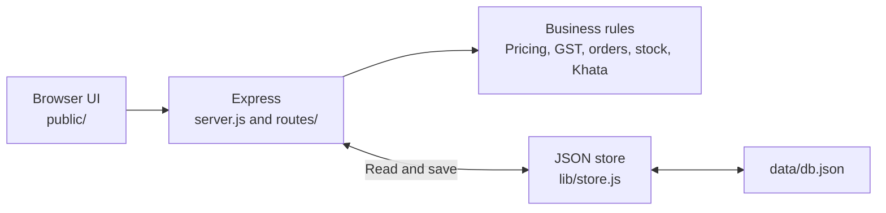

# ShopLedger

ShopLedger is a billing, inventory, and Khata ledger app for wholesale and retail shops. It runs on Node.js and Express with a plain HTML, CSS, and JavaScript interface.

## Run locally

```sh
npm install
npm start
```

Open [http://localhost:3000](http://localhost:3000). Set `PORT` to use a different port. Sales, cancellations, and settlements update the app's local JSON file at `data/db.json`. Use a disposable copy of the project and synthetic data when trying those workflows.

## Verify the fixes

Run the full suite from the project root with `node --test`. The tests use Node's built-in test runner and in-memory fixtures. They never read or write `data/db.json`.

| Reported issue | What changed | Example to verify |
| --- | --- | --- |
| [#1 · Invoice and GST](https://github.com/SampurnR/shopledger-legacy-workshop/issues/1) | The invoice uses the recorded order totals and shares checkout's GST slab, discount, and rounding logic for line items. | A mixed 5% and 12% GST order with `SAVE10` shows ₹2,007.25 total and ₹157.25 GST in checkout and on the invoice. The GST reconciliation report marks the order as matched. |
| [#2 · Last sellable unit and cancellation](https://github.com/SampurnR/shopledger-legacy-workshop/issues/2) | Checkout considers the combined quantity across lines for each product. Cancelling restores physical stock once and preserves wholesale holds. | With four units on hand and three held, a sale of one unit succeeds and a second sale is rejected. Cancelling an order restores each quantity sold. |
| [#3 · Order history](https://github.com/SampurnR/shopledger-legacy-workshop/issues/3) | History sorts by calendar date and uses inclusive date bounds. Orders on the same date show the higher ID first. | March orders appear above January and December orders. A January 1–31 filter returns only January orders. |
| [#3 · Khata settlements](https://github.com/SampurnR/shopledger-legacy-workshop/issues/3) | The ledger validates payment amounts and updates balances using whole paise. | A ₹500 payment raises the settled total from ₹1,200 to ₹1,700 and lowers the balance due from ₹1,232.01 to ₹732.01. |

Historical orders store aggregate GST. When an invoice is printed, its line GST is reconstructed using the current rate rules and the recorded discount. Existing balances affected by past settlement errors require reconciliation against verified payment records.

## Architecture

[Open the HTML diagram in the running app](http://localhost:3000/architecture.html). You can also download the [standalone HTML file](public/architecture.html) and open it offline. It includes the system map, checkout sequence, and the invoice, cancellation, order history, and settlement flows.



## Module map

- `server.js` serves the interface and printable invoices. `routes/` handles the order, product, customer, and report APIs.
- `lib/pricing.js`, `lib/tax.js`, `lib/coupons.js`, and `lib/invoice.js` handle billing and invoices.
- `lib/inventory.js`, `lib/orders.js`, `lib/dates.js`, and `lib/ledger.js` handle stock, order history, and Khata.
- `lib/store.js` reads and writes the JSON file. `lib/reports.js` builds dashboard and GST reconciliation reports. `public/` contains the browser interface.
